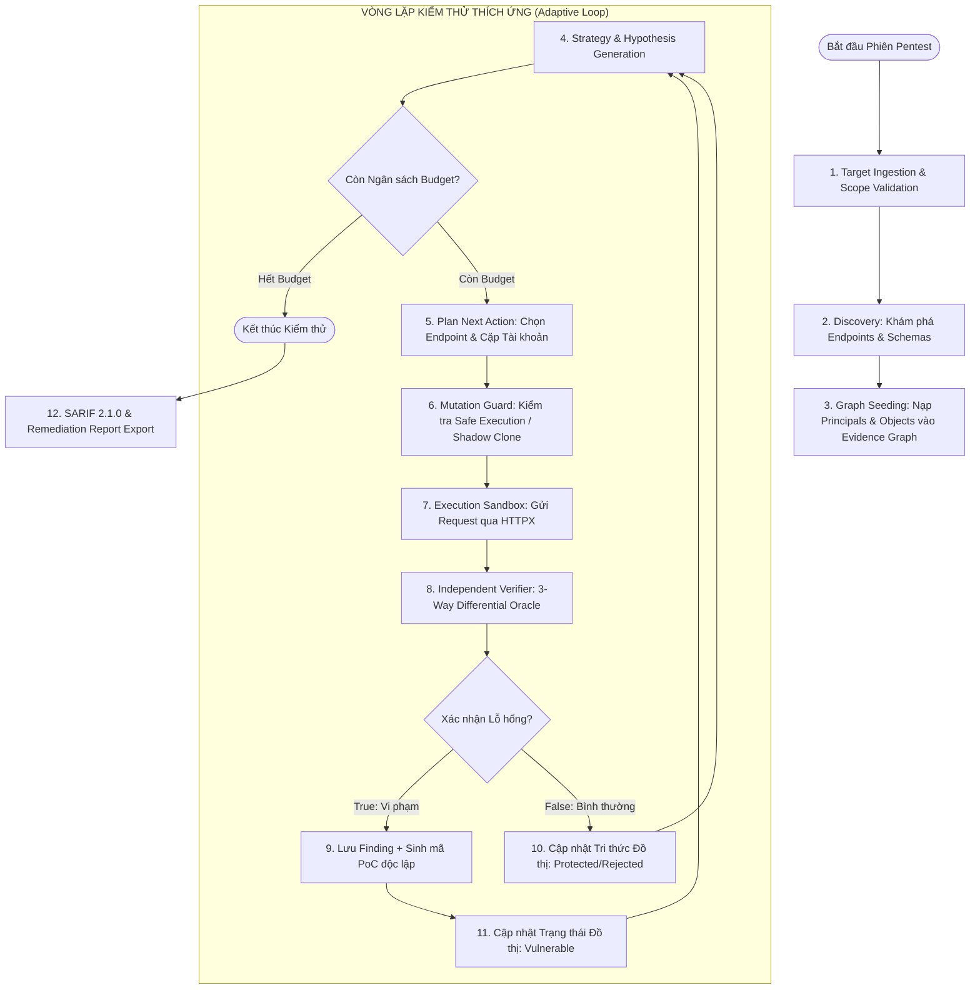

# FLOW.md — Quy trình Nghiệp vụ & Luồng Dữ liệu Chi tiết

---

## 1. Sơ đồ Luồng Tổng thể (End-to-End Workflow)

---

## 2. Chi tiết 4 Pha Vận hành

### Pha 1: Khởi tạo & Trinh sát (Ingestion & Discovery)
1. Người dùng hoặc CI Pipeline kích hoạt CLI:
   `agentic-pentest run --spec api/openapi.json --target http://localhost:8888 --credentials test_users.json`
2. **OpenAPI Parser**: Phân rã cấu trúc OpenAPI/Swagger:
   - Trích xuất URL paths, HTTP verbs, tham số đường dẫn (e.g. `{order_id}`, `{vehicle_vin}`).
   - Xác định cơ chế Authentication (Bearer JWT, Cookie, API Key).
3. **Graph Initialization**: Khởi tạo các Node ban đầu trong NetworkX Evidence Graph:
   - Các Nodes `Principal`: `Alice` (Standard User), `Bob` (Standard User), `Admin`.
   - Các Nodes `Endpoint`: `/identity/api/v2/vehicle/{id}/location`, `/workshop/api/merchant/contact_mechanic`.

### Pha 2: Thu hoạch Đối tượng (Object Harvesting)
1. Để test BOLA, Agent không được "bịa" ID ngẫu nhiên.
2. Agent dùng tài khoản của Alice để gọi các endpoint trinh sát hợp lệ (e.g. `GET /identity/api/v2/vehicle` của Alice) $
ightarrow$ Thu hoạch được `vehicle_id_alice = c636f1b1-...`.
3. Agent dùng tài khoản của Bob gọi tương tự $
ightarrow$ Thu hoạch được `vehicle_id_bob = a112e4f0-...`.
4. Ghi nhận quyền sở hữu hợp pháp vào Evidence Graph:
   - Cạnh: `(Alice) --[OWNS]--> (Vehicle_A)`
   - Cạnh: `(Bob) --[OWNS]--> (Vehicle_B)`

### Pha 3: Lập kế hoạch Thích ứng & Bắn Thử nghiệm (Hypothesis & Execution)
1. **Adaptive Planner** nhận thấy có tài nguyên `Vehicle_A` thuộc về Alice và endpoint `/identity/api/v2/vehicle/{id}/location` nhận tham số `{id}`.
2. Sinh giả thuyết: *"Bob có thể xem vị trí xe của Alice bằng cách đổi ID trên URL"*.
3. **Mutation Guard**: Kiểm tra xem method có phải `PUT/DELETE` không. Vì đây là `GET` (đọc dữ liệu), cho phép thực thi trực tiếp không cần Shadow Clone.
4. **HTTPX Executor**: Gửi request với token của Bob nhưng ID là `vehicle_id_alice`.

### Pha 4: Xác minh Đối chứng & Sinh PoC (Verification & PoC)
1. Phản hồi trả về `HTTP 200 OK` kèm toạ độ GPS.
2. **Differential Invariant Oracle** kích hoạt 2 request đối chứng:
   - Lấy mẫu hợp lệ của Alice trên `Vehicle_A`.
   - Lấy mẫu hợp lệ của Bob trên `Vehicle_B`.
3. So sánh AST JSON: Toạ độ GPS và biển số xe trong kết quả tấn công trùng 100% với xe của Alice $
ightarrow$ **Xác nhận BOLA thành công**.
4. **PoC Generator**: Tự động viết file `reproduce_poc_bola_vehicle.py` lưu vào thư mục `reports/pocs/`.
5. **SARIF Exporter**: Đóng gói kết quả thành `report.sarif` để gửi lên GitHub Security Center.
