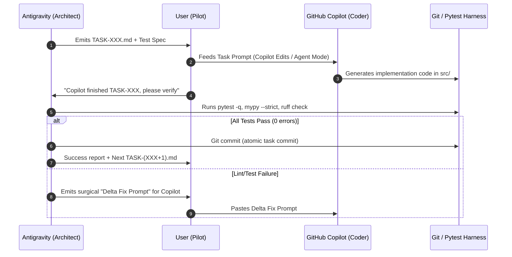

# Dual-Agent Orchestration Protocol: Antigravity IDE + GitHub Copilot

> **Target Objective**: Maximize development speed and code quality while efficiently burning the user's 1,500 GitHub Copilot credits without context overflow or architectural drift.

---

## 1. Division of Responsibilities

| Dimension | Antigravity (This Agent) | GitHub Copilot (Agent Mode / Edits) |
| :--- | :--- | :--- |
| **Primary Persona** | Chief Architect, Invariant Verifier & QA Oracle | Fast Implementation Engine & File Editor |
| **Execution Domain** | Background planning, test harness execution, verification, git management | Interactive IDE edits, code generation inside files |
| **Credit Consumption** | Free IDE agent (DeepMind/Google Antigravity context) | Consumes user's 1500 Copilot credits (Auto/Balanced mode) |
| **Key Invariant** | Sole authority over test verification and Architecture rules | Strictly adheres to task prompts; never changes interfaces |

---

## 2. The 5-Step Handshake Loop



---

## 3. How to Run Copilot Efficiently (Saving Credits & Maximizing Accuracy)

1. **Model Selection in Copilot**:
   - Use **Auto Mode** or **Claude Haiku / GPT-4o-mini** for standard entity creation, data structures, and boilerplate.
   - Use **Claude Sonnet 3.5 / 3.7** only when implementing complex graph algorithms or differential AST parsers.
2. **Context Window Protection**:
   - Do NOT feed entire repositories to Copilot.
   - Simply prompt Copilot:
     ```text
     Implement according to the requirements in tasks/TASK-001-domain-entities.md.
     Follow Clean Architecture. Do not import external HTTP or DB libraries in domain/.
     ```
3. **Preventing Hallucinations**:
   - Antigravity pre-creates the corresponding test file (`tests/unit/test_xxx.py`) before handing the task to Copilot. Copilot's code will be validated against this exact contract.

---

## 4. Current Task Roadmap

- [x] **TASK-000**: Workspace initialization, Go prober engine, Docker environment, and benchmark ground truth.
- [ ] **TASK-001**: Pure Domain Entities (`src/agentic_pentest/domain/entities.py`).
- [ ] **TASK-002**: Domain Invariants & Semantic Diff Engine (`src/agentic_pentest/domain/invariants.py`).
- [ ] **TASK-003**: 3-Way Differential Invariant Verifier (`src/agentic_pentest/application/verifier/differential_verifier.py`).
- [ ] **TASK-004**: Hybrid Evidence Graph (NetworkX + SQLite) (`src/agentic_pentest/infrastructure/graph/`).
- [ ] **TASK-005**: Adaptive BOLA/BFLA Planner (`src/agentic_pentest/application/planner/`).
- [ ] **TASK-006**: Zero-Dependency PoC Generator (`src/agentic_pentest/application/poc/`).
