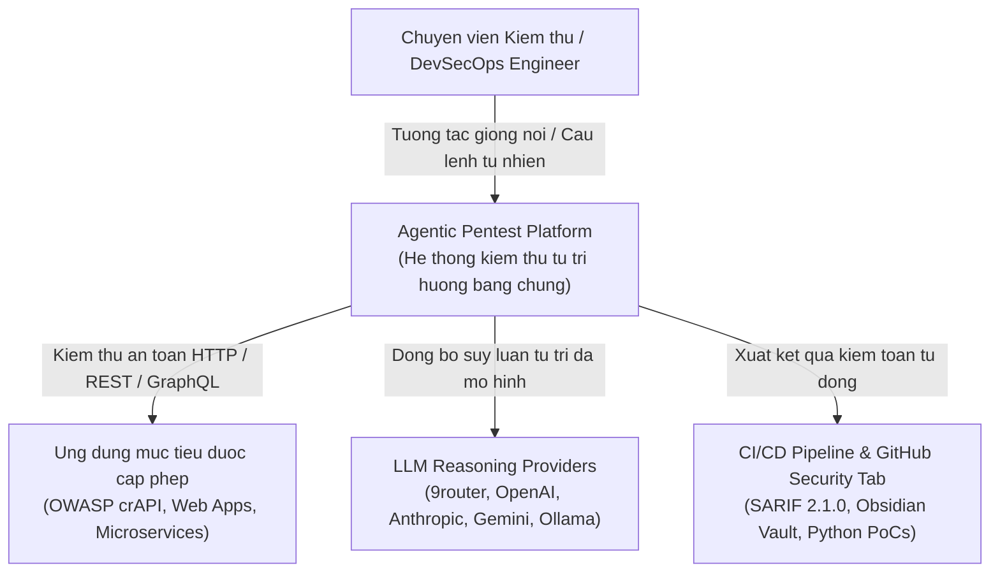
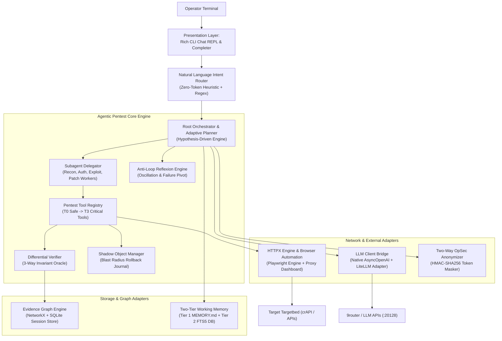
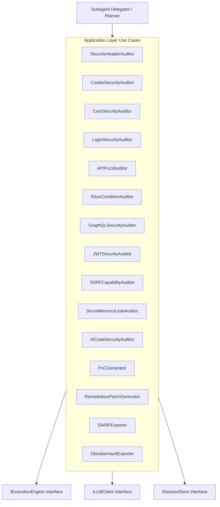
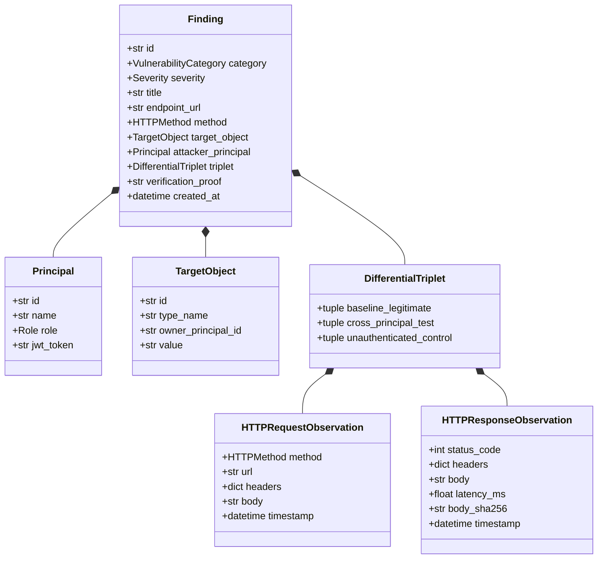
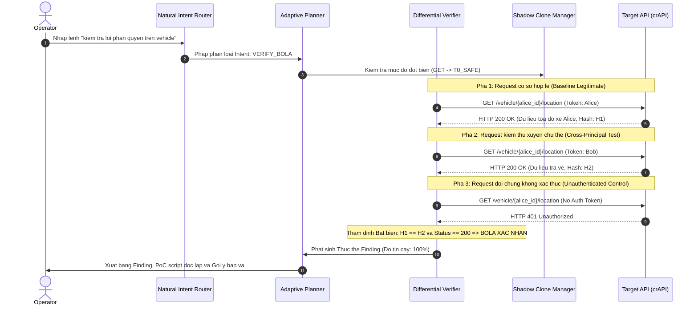

# DAC TA TOAN DIEN HE THONG AGENTIC PENTEST PLATFORM

## MUC LUC

1. Tong quan he thong va Dinh danh kien truc
2. Tu duy cot loi (Mindset) va Phuong phap luan kiem thu
3. Danh muc chuc nang toan dien tu A den Z
4. Kien truc he thong theo mo hinh C4 Model
5. Quy trinh van hanh va Luong du lieu he thong
6. He thong cong cu, Moi truong thuc thi va Co che OpSec
7. Nen tang cong nghe, Thu vien va Quan ly phu thuoc
8. Huong dan cai dat va Thiet lap moi truong
9. So tay lenh tuong tac va Khung dieu khien CLI REPL
10. Phan tich rui ro che do loi he thong theo FMEA
11. Ma tran doi sanh tieu chuan quoc te va Khung quan tri an ninh
12. Ho so quyet dinh kien truc he thong (ADR)
13. Danh gia uu diem, Nhuoc diem va Gioi han he thong
14. Kha nang mo rong, Tu dong cai tien va Lo trinh phat trien

---

## 1. TONG QUAN HE THONG VA DINH DANH KIEN TRUC

### 1.1. Dinh nghia he thong
Agentic Pentest Platform la he thong kiem thu xam nhap ung dung Web va API tu tri huong bang chung (Evidence-Guided Autonomous Penetration Testing System). He thong ket hop nang luc suy luan logic cua mo hinh ngon ngu lon (Large Language Models) voi cong nghe mo hinh hoa do thi bang chung thoi gian thuc (In-Memory Evidence Graph) va co che tham dinh vi pham bat bien vi phan 3 chieu (3-Way Differential Invariant Oracle).

Khac biet can ban voi cac may quet truyen thong (vvon chi fuzzing payload theo mau) va cac wrapper LLM don gian (chi goi tool qua prompt tho), Agentic Pentest Platform hoat dong theo nguyen ly Lap ke hoach huong gia thuyet (Hypothesis-Driven Planning), Duy tri trang thai phien phan cap (Dual-Tier Session Memory), Bao ve pham vi dot bien du lieu (Blast Radius & Shadow Object Cloning), va Cam ket ty le bao dong gia bang khong (Zero False-Positive Guarantee).

### 1.2. Muc tieu he thong
- Tu dong hoa phat hien va xac minh cac lo hong nghiep vu nghiem trong nhat tren API hien dai thuoc OWASP API Security Top 10, trong do trong tam dac biet la BOLA/IDOR (Broken Object Level Authorization), BFLA (Broken Function Level Authorization), SSRF (Server-Side Request Forgery), TOCTOU Race Condition, va JWT Signature Bypass.
- Ho tro dieu khien kiem thu hoan toan bang ngon ngu tu nhien (tieng Viet va tieng Anh), tu dong suy luan y dinh (Zero-Token Heuristic Intent Routing) de lua chon cong cu thuc thi toi uu.
- San sinh ma nguon khai thac doc lap (Zero-Dependency Reproducible PoC) chay truc tiep bang thu vien chuan Python (urllib/requests) de nha phat trien co the tai hien lap tuc ma khong can cai dat bat ky framework nao.
- Xuat bao cao chuan hoa cong nghiep OASIS SARIF 2.1.0 va kho tri thuc Obsidian Markdown Vault phuc vu kiem toan bao mat.

---

## 2. TU DUY COT LOI (MINDSET) VA PHUONG PHAP LUAN KIEM THU

### 2.1. Sau tru cot tu duy cua chuyen gia kiem thu
He thong duoc thiet ke mo phong truc tiep 6 nguyen ly tu duy cot loi cua chuyen gia bao mat thuc chien:

1. Think in Attack Surface: Khong tiep can ung dung chi o lop giao dien ben ngoai. He thong lap ban do toan bo cac diem tiep xuc du lieu: HTTP headers, cookies, URL parameters, request body schemas, GraphQL queries, WebSocket frames, JWT claims, va cac ranh gioi tin cay (Trust Boundaries).
2. Challenge Assumptions: Luon dat cau hoi phan bien doi voi moi gia dinh cua nha phat trien. Neu he thong gia dinh nguoi dung chi co the doc du lieu xe cua chinh minh, can lap tuc kiem chung dieu gi se xay ra neu token cua Alice yeu cau ID xe cua Bob.
3. Think in Hypotheses: Khong gui payload ngau nhien hoac quet mu. Moi hanh dong kiem thu deu phai duoc dinh hinh duoi dang mot gia thuyet xac dinh, co tieu chi phan bien va ket qua ky vong ro rang.
4. Think in Chains: Khong coi mot loi la su kien don le. He thong xau chuoi cac phat hien: ro ri thong tin qua loi 500 hoac heapdump dan den lay duoc token hoac object ID, tu do mo duong khai thac BOLA tren API noi bo.
5. Prove Impact, Not Just Behavior: Mot ma phan hoi HTTP 500 khong dong nghia voi co lo hong. Chi khi chung minh duoc quyen truy cap bi pha vo, du lieu nhay cam bi trich xuat hoac trang thai he thong bi thay doi trai phep moi xac nhan finding.
6. Think Like the Defender: Moi phat hien lo hong phai di kem voi phan tich nguyen nhan goc (Root Cause Analysis), telemetry log can theo doi o SOC/SIEM, va ban va ma nguon mau (Remediation Diff) de giup lap trinh vien khac phuc triet de.

### 2.2. Phuong phap luan kiem thu tuan thu tieu chuan
He thong van hanh theo quy trinh 7 giai doan tieu chuan hoa:
- PTES (Penetration Testing Execution Standard): Tu Pre-engagement Interactions, Intelligence Gathering, Threat Modeling, Vulnerability Analysis, Exploitation, Post-Exploitation den Reporting.
- OWASP WSTG (Web Security Testing Guide v4.2) va OWASP ASVS v4.0.3 (Application Security Verification Standard).
- Cyber Kill Chain (Lockheed Martin): Reconnaissance -> Weaponization -> Delivery -> Exploitation -> Installation -> Command and Control -> Actions on Objectives.
- MITRE ATT&CK va MITRE D3FEND: Anh xa ky thuat tan cong va bien phap phong thu tuong ung.

---

## 3. DANH MUC CHUC NANG TOAN DIEN TU A DEN Z

### 3.1. Nhom chuc nang trinh sat va lap ban do be mat (Reconnaissance & Mapping)
- Security Headers Auditor (K2): Quet toan dien cac HTTP headers bao ve (Strict-Transport-Security, Content-Security-Policy, X-Frame-Options, X-Content-Type-Options, Referrer-Policy, Permissions-Policy). Danh gia diem an toan tren thang diem 100 kem canh bao rui ro Clickjacking va XSS.
- Cookie & Session Security Auditor (K5): Kiem tra thuoc tinh bao ve cua toan bo cookie phien (`HttpOnly`, `Secure`, `SameSite`). Nhan dien nguy co danh cap phien qua XSS hoac tan cong CSRF.
- Cross-Origin Resource Sharing (CORS) Auditor (K6): Kiem tra cac cau hinh sai CORS qua phan xa Origin tuy y (`evil.com`, `null`), ket hop voi chi thi `Access-Control-Allow-Credentials: true` de phat hien nguy co rò ri du lieu xuyen goc.
- Passive Login Portal Auditor (K3): Kiem tra ranh gioi van chuyen HTTPS tren trang dang nhap, nguy co ro ri form du lieu qua Cache-Control va bo dem trinh duyet.
- Sensitive Endpoints & Artifacts Fuzzer: Quet phat hien cac tap tin va duong dan nhay cam de lo nhu `/.env`, `/.git/HEAD`, `/actuator/env`, `/actuator/heapdump`, `/actuator/health`, `/swagger.json`, `/openapi.json`, `/metrics`.
- Dynamic Single Page Application (SPA) Crawler: Tich hop Playwright Headless Browser de crawl sau vao cac ung dung React, Angular, Vue, tu dong nhan dien interactive elements, cào cac endpoint ngam va trich xuat API routes tu ma nguon JavaScript.

### 3.2. Nhom chuc nang xac thuc va kiem soat truy cap (Authentication & Authorization)
- 3-Way Differential Invariant Oracle (BOLA/IDOR - K4): Thuc hien kiem thu xuyen chu the (Cross-Principal Testing) giua hai tai khoan Alice va Bob. Kiem tra tinh toan ven cua bat bien co lap doi tuong (Object Isolation Invariant) bang cach hoan doi token va doi chieu hash SHA-256 cua du lieu phan hoi.
- Broken Function Level Authorization (BFLA) Verifier: Kiem tra su thieu hut kiem tra quyen han tren cac chuc nang quan tri (`/admin/api`, endpoint dot bien du lieu POST/PUT/DELETE) khi goi bang token nguoi dung thong thuong.
- JWT Security Suite:
  - Thu nghiem bypass thuat toan `alg=none`.
  - Tan cong gia mao tham so Header JKU/KID.
  - Offline Dictionary Attack kiem tra khoa bi mat yeu (HMAC-SHA256 secret brute-force) tren token JWT.
- Benchmark Account Seeder: Tu dong ket noi API dong bo va dang ky cac cap tai khoan kiem thu hop le tren OWASP crAPI phuc vu moi truong testbed.

### 3.3. Nhom chuc nang nghiep vu nang cao va tan cong logic (Business Logic & Advanced Exploits)
- TOCTOU Race Condition Auditor: Su dung co che dong bo da luong (Multi-threaded HTTP Burst) de gui dong thoi 10 den 20 request trong khoang thoi gian duoi 10 mili-giay, phat hien cac lo hong gian lan voucher, nap tien nhieu lan hoac ghi de trang thai he thong.
- GraphQL Attack Suite:
  - Tu dong phat hien va khai thac GraphQL Introspection Query.
  - Do tim do sau truy van (Query Depth Attack) va tan cong tu choi dich vu qua de quy (Denial of Service via Circular Queries).
  - Batching Attack bypass co che gioi han toc do (Rate Limiting Bypass qua Array Queries).
- Server-Side Request Forgery (SSRF) & Cloud Metadata Pivot:
  - Do tim tham so chua URL callback.
  - Kiem thu truy cap vao dia chi Loopback (`127.0.0.1`, `localhost`) va Cloud Instance Metadata Services (AWS IMDSv1 `169.254.169.254`, GCP Metadata, Azure Metadata).
- Secret & Memory Leak Auditor: Quet phan hoi tim kiem API keys, AWS credentials, JWT tokens, private keys, va database connection strings bi lo sot trong body hoac error stack traces.
- AI Code Security Guard (SAST Taint Analysis): Phan tich cay cu phap truutuong (AST) cua ma nguon do AI sinh ra de phat hien cac lo hong thuc thi lenh he thong (`eval`, `exec`, `subprocess`), SQL Injection, Path Traversal va memory sink.

### 3.4. Nhom chuc nang cam nang kien thuc nhan thuc (Knowledge & Binary Architecture)
- Memory Segment Map: Cung cap so do chi tiet 8 phan vung bo nho tien trinh x86_64 (.text, .rodata, .data, .bss, [heap], mmap/libc, [stack], PLT/GOT).
- Mitigations & Bypass Guide: Huong dan toan dien chien luoc vuot qua ASLR (Memory Leak), PIE (Partial Overwrite), NX/DEP (ROP Chain), Stack Canary (Leak/Fork brute-force), RELRO (FSOP, Hook overwrite).
- Advanced Exploitation Classes: He thong hoa ly thuyet va workflow khai thac Use-After-Free (UAF), Double Free, Tcache Poisoning (kem giai thuat mangling `target ^ (chunk >> 12)` tu glibc 2.32+), Fastbin Dup, FSOP (`_IO_FILE`), Stack Pivot, SROP (`rt_sigreturn`), Type Confusion.
- Pentest Toolchain Matrix: Ban do cong cu 7 giai doan chuan hoa cong nghiep tu Reconnaissance den Binary Reverse Engineering.

### 3.5. Nhom chuc nang dieu phoi, an ninh va bao cao (Orchestration, OpSec & Reporting)
- Subagent Delegation Engine: Mo hinh Graph of Agents phan chia nhiem vu tu Root Orchestrator sang cac Subagents chuyen biet (`RECON_WORKER`, `AUTH_AUDIT_WORKER`, `LOGIC_EXPLOIT_WORKER`, `REMEDIATION_WORKER`) voi han muc ngan sach token doc lap.
- Reflexion & Anti-Loop Engine: Tu dong theo doi vet thuc thi, phat hien vong lap 3 lan that bai hoac dao dong ping-pong de kich hoat co che chuyen huong chien thuat (Backtrack & Pivot).
- Two-Way OpSec Anonymization: Proxy ma hoa an danh hai chieu bang HMAC-SHA256, thay the toan bo IP, JWT token, email that bang token gia dinh truoc khi truyen len Cloud LLM va tu dong khoi phuc lai khi tra ve terminal.
- Blast Radius & Shadow Object Cloning: Tu dong nhan ban doi tuong truoc khi thuc hien cac thao tac bien doi du lieu (PUT/DELETE/PATCH), dam bao an toan tuyet doi cho du lieu goc.
- Zero-Dependency PoC Generator: Tu dong sinh script Python doc lap, su dung thu vien chuan `urllib` hoac `requests`, kiem tra tinh xac thuc bang exit code.
- Remediation Patch Generator: Sinh ma nguon git diff chua lop middleware kiem tra quyen truy cap muc doi tuong theo chuan FastAPI/Python de nha phat trien tich hop ngay.
- OASIS SARIF 2.1.0 Exporter: Xuat ket qua theo dinh dang chuan hoa cong nghiep de tich hop truc tiep vao GitHub Actions Security Tab hoac SonarQube.
- Obsidian Knowledge Vault Exporter: Xuat toan bo phien kiem thu thanh cay thu muc Markdown kem lien ket cheo (Wikilinks) mo truc tiep trong Obsidian.

---

## 4. KIEN TRUC HE THONG THEO MO HINH C4 MODEL

He thong Agentic Pentest duoc thiet ke tuan thu tuyet doi quy tac Dependency Inversion Principle va Clean Architecture (Inward Rule). `domain/` chua toan bo thuc the thuan tuy khong phu thuoc framework; `application/` chua cac use case va interfaces; `infrastructure/` cai dat cac adapters ben ngoai (HTTPX, SQLite, NetworkX, LiteLLM, OpenAI); `presentation/` phu trach giao dien dong lenh CLI va xuat bao cao.

### 4.1. Level 1: System Context Diagram (Ngu canh he thong)



### 4.2. Level 2: Container Diagram (Cac container ung dung)



### 4.3. Level 3: Component Diagram (Cac thanh phan ben trong Application)



### 4.4. Level 4: Code Diagram (Mo hinh lop va quan he thuc the)



---

## 5. QUY TRINH VAN HANH VA LUONG DU LIEU HE THONG

### 5.1. Quy trinh xac minh bat bien vi phan 3 chieu (3-Way Differential Invariant Verification)



---

## 6. HE THONG CONG CU, MOI TRUONG THUC THI VA CO CHE OPSEC

### 6.1. Phan cap rui ro cong cu (Tool Risk Tiers)
De dam bao an toan tuyet doi trong moi truong production/staging, he thong phan cap moi cong cu theo 4 cap do rui ro:
- T0_SAFE: Cac lenh kiem thu doc hoan toan (Read-Only GET), khong gay thay doi trang thai he thong. Tu dong duoc phep chay trong moi che do.
- T1_PROBE: Cac tham do khong dot bien (Options reflection, header fuzzing). Co the gui tham so moi nhung khong ghi de co so du lieu.
- T2_ACTIVE: Kiem thu phan quyen cheo giua cac chu the (Cross-principal data read). Yeu cau xac nhan trong che do strict.
- T3_CRITICAL: Cac thao tac dot bien du lieu mang tinh pha huy (POST, PUT, DELETE). Bat buoc phai co Shadow Object Cloning va nhat ky rollback hoac xac nhan truc tiep tu chuyen vien.

### 6.2. Co che bao ve du lieu an danh hai chieu (OpSec Anonymization)
Nham tuan thu nghiem ngat luat an ninh mang va cac hop dong bao mat thong tin (NDA), he thong tich hop Lop an danh hai chieu:
- Chieu Outbound: Moi request chua IP muc tieu, dia chi email, khoa bi mat, token JWT deu duoc quet va thay the bang token gia dinh nhat quan dua tren thuat toan Longest-First Matching va HMAC-SHA256 (`TARGET_IP_1`, `AUTH_TOKEN_ALICE`, `USER_BOB`).
- Chieu Inbound: Khi LLM tra ve ket qua phan tich, bo giai ma Tolerant Restorer tu dong doi nguoc cac token gia ve gia tri nguyen ban truoc khi xuat ra man hinh terminal cua pentester.

---

## 7. NEN TANG CONG NGHE, THU VIEN VA QUAN LY PHU THUOC

### 7.1. Danh muc cong nghe va thu vien loi
- Ngon ngu thuc thi: Python 3.11+ / Python 3.13 (x86_64).
- Engine mang va HTTP: `httpx` (ho tro asynchronous HTTP/2, connection pooling, proxy routing), `requests` (dung cho reproduction PoC).
- Trinh duyet tu dong: `playwright` (dieu khien trinh duyet Chromium khong dau, danh chan request/response DOM, render SPA).
- Mo hinh hoa do thi va du lieu: `networkx` (xay dung cay tri thuc bang chung Evidence Graph), `pydantic` v2 (kiem tra rang buoc du lieu schema).
- Giao tiep mo hinh ngon ngu lon: `openai` Python SDK (native AsyncOpenAI bridge cho cac proxy cuc bo nhu 9router), `litellm` (ho tro goi da nha cung cap OpenAI, Anthropic, Gemini, Groq, Ollama).
- Luu tru phien lam viec: `sqlite3` tich hop Full-Text Search (FTS5) quan ly phien va nhat ky bang chung.
- Giao dien dong lenh chuyen nghiep: `rich` (render bang mau, hop thoai panel, layout dashboard), `prompt_toolkit` (ho tro auto-suggestion, syntax completion, command history, multi-line keybindings).
- Chat luong ma nguon va kiem thu: `ruff` (linter va formatter toc do cao), `mypy` (kiem tra kieu tinh nghiem ngat `--strict`), `pytest` va `pytest-asyncio` (khung kiem thu don vi).

---

## 8. HUONG DAN CAI DAT VA THIET LAP MOI TRUONG

### 8.1. Yeu cau he thong
- He dieu hanh: Windows 10/11 (PowerShell 7+), Linux (Ubuntu 22.04+), macOS (Sonoma+).
- Python: Phien ban 3.11 tro len.
- Docker & Docker Compose: Dung de chay testbed ung dung mau (OWASP crAPI).

### 8.2. Cac buoc thiet lap moi truong tu A den Z

```powershell
# Buoc 1: Khoi tao va kich hoat moi truong ao Python
python -m venv .venv
.venv\Scripts\Activate.ps1    # Tren Windows
# source .venv/bin/activate   # Tren Linux / macOS

# Buoc 2: Cai dat toan bo thu vien phu thuoc runtime va dev
pip install -r requirements.txt
pip install -r requirements-dev.txt

# Buoc 3: Cai dat trinh duyet Playwright (tuy chon cho tinh nang /browser)
playwright install chromium

# Buoc 4: Khoi tao file cau hinh moi truong
cp .env.example .env
```

### 8.3. Cau hinh tep `.env`
Mo tep `.env` va thiet lap cac thong so co ban:
```ini
TARGET_BASE_URL=http://localhost:8888
CRAPI_SPEC_PATH=fixtures/crapi_openapi.json

# Chinh sach an toan
ALLOWED_HOSTS=localhost,127.0.0.1,localhost:8888
PERMISSION_MODE=interactive # strict, interactive, auto-approve
SAFE_MODE=true              # bat co che Shadow Object Cloning
OPSEC_ANONYMIZATION=true    # bat che do ma hoa an danh du lieu

# Cau hinh AI Gateway (Ho tro 9router hoac truc tiep)
OPENAI_BASE_URL=http://localhost:20128/v1
OPENAI_API_KEY=sk-a5ffd8258bfcc750-cpj2yd-115b28df
OPENAI_MODEL=gemini/gemini-3.6-flash # hoac ds/deepseek-chat, claudecode
FALLBACK_OFFLINE=true                # tu dong chuyen sang heuristic neu mat mang
```

---

## 9. SO TAY LENH TUONG TAC VA KHUNG DIEU KHIEN CLI REPL

He thong cung cap giao dien dong lenh phong phu, ho tro ca lenh truc tiep (Slash commands) va cau hoi tu nhien.

```text
Lenh he thong      Mo ta chuc nang                                          Nhom Use Case
-------------      --------------------------------------------------       -------------
/scan hoac /bola   Kich hoat 3-Way Differential Oracle quet BOLA/IDOR       UC-5 (K4, K8)
/race              Kiem thu TOCTOU Race Condition da luong microsecond      Advanced Logic
/graphql           Kiem thu GraphQL Introspection, Query Depth & Batching   Advanced Logic
/jwt               Kiem thu thuat toan None, gia mao JKU va crack secret    UC-4 (K3)
/secrets           Kiem thu ro ri khoa bi mat, API keys trong response      K7
/sast              Quet AST Taint Analysis phat hien ma nguon AI bat an     Code Guard
/headers           Rà soat cau hinh HTTP Security Headers va tinh diem      UC-1 (K2)
/cookies           Danh gia an toan cookie phien (HttpOnly, Secure, Same)   UC-2 (K5)
/cors              Kiem thu nguy co ro ri du lieu qua chia se goc chéo      UC-3 (K6)
/login             Kiem thu an toan trang dang nhap va cache form           UC-4 (K3)
/seed              Tu dong tao va dong bo token tai khoan kiem thu crAPI    Setup
/fuzz              Fuzzing endpoint an, file lo lot (.env, heapdump, git)   Recon (K1)
/exploit [topic]   Tra cuu cam nang bo nho, ROP, Canary, ASLR, Heap UAF     Knowledge
/delegate          Phan ra nhiem vu cho Subagents (Strix Graph of Agents)   Orchestration
/browser           Crawl sau ung dung bang Playwright Headless Browser      Level 5 Recon
/proxy             Bat/Tat Interception Web Dashboard truc quan (:8090)     GUI Proxy
/model             Do do tre ping ms va kiem tra ket noi AI Gateway         Health Check
/poc [lang]        Xuat ma khai thac PoC doc lap (Python, curl, Go, Node)   UC-5 (K8)
/sarif             Xuat bao cao chuan hoa OASIS SARIF 2.1.0                 Reporting
/vault             Xuat cay tai lieu Obsidian Markdown Knowledge Vault      Reporting
/diff              Xuat ban va ma nguon mau git diff de fix lo hong         Remediation
/loop [turns]      Chay vong lap kiem thu tu tri ReAct kem chong lap        Autonomous
/status            Hien thi thong so Evidence Graph va trang thai phien     Status
/help hoac ?       Hien thi danh muc huong dan lenh chi tiet               Help
exit hoac quit     Thoat khoi phien lam viec                                System
```

---

## 10. PHAN TICH RUI RO CHE DO LOI HE THONG THEO FMEA

Bang phan tich Failure Mode and Effects Analysis (FMEA) danh gia toan dien cac che do loi tiem tang trong qua trinh van hanh agentic pentest tu tri, muc do nghiem trong (Severity - S), tan suat xuat hien (Occurrence - O), kha nang phat hien (Detection - D), va Chi so Uu tien Rui ro (Risk Priority Number - RPN = S * O * D, tren thang diem 1 den 1000):

| ID | Che do loi (Failure Mode) | Nguyen nhan goc (Root Cause) | Anh huong den he thong (System Effect) | S | O | D | RPN | Bien phap kiem soat & giam thieu hien co |
| :---: | :--- | :--- | :--- | :---: | :---: | :---: | :---: | :--- |
| **FM-01** | **Out-of-Scope Target Mutation** (Dot bien ngoai pham vi) | LLM suy luan sai lech URL hoac nhan parameter chuyen huong ngoai domain. | Phat lenh tan cong sang may chu thu ba, vi pham phap ly nghiem trong. | 10 | 2 | 2 | **40** | `ScopeGuardMiddleware` kiem tra nghiem ngat `ALLOWED_HOSTS` o tang mang truoc moi HTTP call. |
| **FM-02** | **Production Data Corruption** (Hong du lieu kiem thu) | Thuc hien thao tac `DELETE` hoac `PUT` truc tiep tren ban ghi goc. | Mat mat du lieu nguoi dung that, gian doan dich vu (DoS). | 9 | 2 | 2 | **36** | `SafeMode` bat buoc `ShadowObjectCloner` nhan ban ban sao va ghi Rollback Journal. |
| **FM-03** | **Hallucinated Vulnerability Verdict** (Bao dong gia) | LLM tu suy dien ma 500 hoac thong bao loi la lo hong nghiem trong. | Ton hao thoi gian phan tich cua doi ngu bao mat, mat uy tin bao cao. | 7 | 2 | 1 | **14** | `DifferentialVerifier` nam doc quyen phan quyet Finding dua tren so sanh hash vi phan. |
| **FM-04** | **Credential & PII Leakage** (Lo thong tin len Cloud) | Request that chua JWT token, password hoac PII gui thang len Cloud LLM. | Vi pham hop dong bao mat (NDA) va quy dinh GDPR/NIST. | 9 | 2 | 2 | **36** | `TwoWayAnonymizer` thay the 100% thuc the nhay cam bang ma hash truoc khi roi khoi may. |
| **FM-05** | **Agent Infinite Tool Execution Loop** (Kẹt vong lap) | Agent lien tuc nhan loi 403 hoac dao dong giua hai hanh dong khong loi thoat. | Chay sach ngan sach token API, treo phien kiem thu. | 6 | 3 | 2 | **36** | `ReflexionAntiLoopEngine` dem 3 lan loi lien tiep va ngat vong lap dao dong (Ping-Pong). |
| **FM-06** | **Subagent Budget Exhaustion** (Chay ngan sach) | Subagent sa da vao endpoint ngo cut khong the thu thap them thong tin. | Chi phi API tang cao, tre tien trinh kiem thu tong the. | 5 | 3 | 2 | **30** | `SubagentBudget` gioi han nghiem ngat so luot turn va token toi da cho moi worker. |
| **FM-07** | **LLM Gateway Endpoint Deprecation** (Mat ket noi AI) | Model tren proxy bi khai tu hoac ngat mang dot ngot (loi 410 Deprecated). | Agent dung hoat dong, khong the tiep tuc phan tich suy luan. | 6 | 4 | 1 | **24** | `LiteLLMClient` ho tro tu dong chuyen tiep fallback sang cac model du phong dang Live. |
| **FM-08** | **Denial of Service via Heavy Fuzzing** (Qua tai dich vu) | Phat luong request qua lon khong kiem soat toc do den endpoint nhay cam. | Sap ung dung backend, anh huong tinh san sang cua he thong. | 8 | 2 | 2 | **32** | Phan cap cong cu (Tool Risk Tier T0-T3) kem co che Rate Limiting va Semaphore kiem soat concurrency. |

---

## 11. MA TRAN DOI SANH TIEU CHUAN QUOC TE VA KHUNG QUAN TRI AN NINH

He thong Agentic Pentest duoc thiet ke dap ung va anh xa truc tiep toi 4 nhom tieu chuan an ninh quoc te:

### 11.1. Quan tri doanh nghiep va An toan thong tin (Governance & Compliance)
- ISO/IEC 27001:2022:
  - Kiem soat A.8.8 (Management of technical vulnerabilities): Tu dong hoa danh gia lo hong dinh ky bang bang chung thuc te.
  - Kiem soat A.8.25 (Secure development lifecycle): Tich hop bao cao SARIF 2.1.0 vao CI/CD pipeline.
  - Kiem soat A.8.29 (Security testing in acceptance): Cung cap PoC tu dong de nghiem thu truoc khi dua vao san xuat.
- NIST Cybersecurity Framework (CSF) 2.0:
  - Chuc nang GOVERN (GV): Quan ly rui ro he thong qua FMEA va Scope Guard.
  - Chuc nang IDENTIFY (ID): Trinh sat be mat tan cong qua OpenAPI va crawler.
  - Chuc nang PROTECT (PR): Bao ve tinh rieng tu qua co che an danh du lieu OpSec.
  - Chuc nang DETECT (DE): Phat hien cac vi pham phan quyen muc doi tuong BOLA/BFLA.
- SOC 2 Type II: Tuan thu cac tieu chi Security, Availability, va Confidentiality thong qua he thong nhat ky kiem toan deterministic va co che bao ve du lieu phien.

### 11.2. Phuong phap luan kiem thu an ninh ung dung (Application Security Standards)
- OWASP Top 10 for API Security:
  - API1:2023 (Broken Object Level Authorization): Module 3-Way Differential Invariant Oracle.
  - API2:2023 (Broken Authentication): Module JWT Security Suite va Login Portal Auditor.
  - API3:2023 (Broken Object Property Level Authorization): Mass Assignment & Secret Memory Leak Auditor.
  - API4:2023 (Unrestricted Resource Consumption): TOCTOU Race Condition va GraphQL Batching Auditor.
  - API5:2023 (Broken Function Level Authorization): BFLA Role-Matrix Verification.
  - API7:2023 (Server Side Request Forgery): SSRF & Cloud IMDS Auditor.
  - API8:2023 (Security Misconfiguration): Security Headers, Cookie Flags, CORS Auditor.
- OWASP ASVS v4.0.3 (Application Security Verification Standard): Dap ung cac tieu chi muc Level 2 va Level 3 ve Access Control (V4), Stored Cryptography (V6), va Error Handling (V7).
- PTES & OSSTMM: Tuan thu quy trinh 7 giai doan kiem thu xam nhap he thong thuc te.

### 11.3. Quan tri an ninh he thong AI va Tac tu tu tri (Agentic AI Governance)
- OWASP Top 10 for Agentic Applications 2026:
  - ASI01 (Agent Goal Hijack): Ngan chan bang Scope Guard va Intent Router co dinh danh.
  - ASI02 (Tool Misuse and Exploitation): Co che Risk Tiers (T0-T3) ngan ngua goi cong cu trai phep hoac dot bien vo to toi.
  - ASI03 (Identity and Privilege Abuse): Ngan chan bang cach tach biet ro rang giua quyen cua cac chu the (Alice vs Bob) va khong cho phep agent dung quyen admin de thao tung.
- ISO/IEC 42001:2023 (Artificial Intelligence Management System - AIMS): He thong nhat ky kiem toan deterministic (Deterministic Audit Trail) luu tru nguyen ban request/response SHA-256 dam bao tinh giai trinh va kha nang truy vet cua he thong AI.
- NIST AI RMF 1.0 (AI Risk Management Framework): Trien khai day du 4 chuc nang Govern, Map, Measure, Manage doi voi rui ro tu dong hoa quyet dinh an ninh.
- Five Eyes Guidance on LLM-based Agentic AI (2026): Tuan thu huong dan bao mat cua 5 co quan an ninh quoc gia ve co lap moi truong thuc thi agent va kiem soat blast radius.

### 11.4. Mo hinh hoa moi de doa (Threat Modeling Frameworks)
- STRIDE (Microsoft):
  - Spoofing: Kiem tra bypass xac thuc JWT va header reflection.
  - Tampering: Kiem tra vi pham tinh toan ven du lieu qua BOLA/BFLA va parameter injection.
  - Repudiation: Ghi nhat ky kiem toan khong the choi cai trong SQLite Session Store.
  - Information Disclosure: Phat hien lo thong tin qua Security Headers, CORS, Heapdump, va Error Traces.
  - Denial of Service: Phat hien qua tai qua Race Condition va GraphQL Depth.
  - Elevation of Privilege: Phat hien leo thang dac quyen doc va ngang.
- PASTA (Process for Attack Simulation and Threat Analysis): 7 buoc mo phong tan cong huong rui ro nghiep vu.

---

## 12. HO SO QUYET DINH KIEN TRUC HE THONG (ADR)

### ADR-001: Tach biet tuyet doi giua Bo lap ke hoach (Adaptive Planner) va Bo tham dinh (Differential Verifier)
- Tinh trang: Da chap thuan va thuc thi nghiem ngat.
- Boi canh: Cac he thong LLM agent thong thuong de bo lap ke hoach tu danh gia ket qua thuc thi, dan den hien tuong confirmation bias va ti le hallucination rat cao.
- Quyet dinh: Bo lap ke hoach chi co quyen quyet dinh *thu nghiem cai gi* (hanh dong nao tiep theo). Duy nhat bo tham dinh `DifferentialVerifier` dua tren so sanh bat bien toan hoc va hash SHA-256 moi co tham quyen xac nhan `Finding`.
- He qua: Loai bo hoan toan rui ro bao dong gia, giu vung nguyen ly Zero-FP.

### ADR-002: Luu tru phien bang chung hai tang (Dual-Tier Session Persistence)
- Tinh trang: Da chap thuan va thuc thi.
- Boi canh: Ngau canh cua LLM bi gioi han boi do dai context window. Dua toan bo log vao prompt se gay qua tai token va suy giam kha nang suy luan.
- Quyet dinh: Su dung bo nho hai tang: Tier 1 (`MEMORY.md`) luu chi so ngan gon duoi 500 tokens de dua vao system prompt; Tier 2 (`agent_sessions.db`) su dung SQLite Full-Text Search de truy van sau khi can.
- He qua: Toi uu hoa chi phi token, giu phien lam viec on dinh ke ca khi kiem thu hang tram endpoints.

### ADR-003: Gioi han ban kinh sat thuong qua co che nhan ban doi tuong (Shadow Object Cloning)
- Tinh trang: Da chap thuan va thuc thi.
- Boi canh: Kiem thu cac thao tac dot bien du lieu (`DELETE`, `PUT`, `PATCH`) de gay hong du lieu moi truong kiem thu.
- Quyet dinh: Moi thao tac dot bien bat buoc phai nhan ban mot doi tuong phu (Shadow Clone) hoac ghi nhat ky vao Rollback Journal de khoi phuc trang thai ban dau sau khi kiem thu xong.
- He qua: He thong co the chay an toan tren cac moi truong testbed ma khong can reset database thu cong.

### ADR-004: Quy tac phu thuoc huong tam trong Clean Architecture
- Tinh trang: Da chap thuan va thuc thi.
- Boi canh: De bi cam do import cac thu vien framework ngoai nhu `httpx`, `sqlite3`, `litellm` vao domain entities.
- Quyet dinh: Lop `domain/` chua pure Python dataclasses va invariants, tuyet doi khong import bat ky thu vien IO ngoai nao. Toan bo IO duoc abstract qua `application/interfaces/`.
- He qua: Code de kiem thu don vi, 114 unit test chay xong trong duoi 35 giay ma khong can khoi dong server hay mo ket noi mang.

### ADR-005: Co che an danh hoa hai chieu phuc vu OpSec
- Tinh trang: Da chap thuan va thuc thi.
- Boi canh: Gui request that len cloud LLM de lo dia chi IP noi bo, token xac thuc va du lieu khach hang.
- Quyet dinh: Thiet lap proxy an danh hoa hai chieu bang thuat toan Longest-First Substitution va HMAC-SHA256, thay the toan bo gia tri nhay cam truoc khi truyen di va khoi phuc lai khi hien thi cho operator.
- He qua: Tuan thu tuyet doi cac quy dinh ve bao ve du lieu va hop dong NDA.

### ADR-006: Kien truc Graph of Subagents va Co che chong lap Reflexion
- Tinh trang: Da chap thuan va thuc thi.
- Boi canh: Root Agent chay tat ca tac vu de bi phan tam, sa da vao chi tiet va de mac ket trong cac vong lap vo nghia.
- Quyet dinh: Ap dung mau thiet ke Graph of Agents (hoc tu Strix) phan chia nhiem vu cho Subagents voi ngan sach rieng biet, ket hop bo do tim vong lap dao dong (hoc tu PentAGI) de chu dong chuyen huong chien thuat sau 3 lan that bai.
- He qua: Agent van hanh tu tri lien tuc, tiet kiem token va khong bao gio bi treo vo han.

---

## 13. DANH GIA UU DIEM, NHUOC DIEM VA GIOI HAN HE THONG

### 13.1. Uu diem vuot troi (Strengths)
1. Do tin cay tuyet doi (Zero False-Positive): Nho co che 3-Way Differential Invariant Oracle, he thong chi canh bao khi co bang chung toan hoc vi pham phan quyen giua hai chu the.
2. Bao ve toan ven du lieu (Blast Radius Protection): Co che Shadow Object Cloning cho phep kiem thu ca cac thao tac pha huy ma khong lam hong co so du lieu testbed.
3. Kien truc phan tang sach se (Clean Architecture): Decoupling hoan toan giua domain, use cases va adapters, cho phep thay the cong cu, co so du lieu hoac model LLM ma khong anh huong den loi nghiep vu.
4. Kha nang van hanh linh hoat (Zero-Token Heuristic + Multi-Model): Ho tro giao tiep tu nhien bang ca tieng Viet va tieng Anh; neu mat mang hoac LLM gap loi, he thong tu dong chuyen sang che do Heuristic van hanh 100% doc lap.
5. Bang chung kiem toan ro rang (Reproducible PoC & SARIF): Tu dong sinh script Python doc lap va bao cao SARIF 2.1.0 tich hop thang vao CI/CD pipeline.

### 13.2. Nhuoc diem va Gioi han hien tai (Weaknesses & Limitations)
1. Pham vi trong tam hien tai: He thong duoc toi uu hoa sau nhat cho lo hong Web va API cap do nghiep vu (BOLA, BFLA, Race Condition, JWT, SSRF). Cac linh vuc nhu khai thac nhị phan (Binary Exploitation/Pwn), Reverse Engineering ma may ELF, hoac leo thang dac quyen Active Directory hien tai moi dung lai o muc do cam nang kien thuc huong dan (Knowledge Advisor) chu chua tu dong nap shellcode vao bo nho tien trinh.
2. Phu thuoc vao tinh san sang cua muc tieu: De phat hien BOLA, he thong yeu cau phai co it nhat hai chu the kiem thu hop le (Alice va Bob). Neu muc tieu khong cho phep dang ky hai tai khoan hoac thieu co che cap phat tai nguyen so huu, do bao phu se bi han che.
3. Gioi han cua trinh duyet khong dau: Chuc nang crawl SPA bang Playwright yeu cau tai nguyen may chu dang ke (RAM/CPU), co the lam cham tien trinh khi quet cac website co hang ngan trang giao dien phuc tap.

---

## 14. KHA NANG MO RONG, TU DONG CAI TIEN VA LO TRINH PHAT TRIEN

### 14.1. Kha nang mo rong cong cu qua giao thuc Model Context Protocol (MCP)
Nho kien truc Registry phan tang, he thong co the mo rong them bat ky cong cu moi nao ma khong can viet lai loi:
- De bo sung mot cong cu moi (vi du: SQLMap runner, Nuclei scanner, Nmap port scanner), chi can cai dat interface `IPentestTool`, khai bao metadata phan cap rui ro (T0-T3) va dang ky vao `PentestToolRegistry`.
- Tuong thich san voi cac MCP Servers nhu `hexstrike-ai`, cho phep ket noi hon 150 cong cu bao mat qua giao thuc JSON-RPC tieu chuan.

### 14.2. Co che tu dong hoc hoi va cai tien (Closed-Loop Learning)
- Tich hop he thong Episodic Memory luu tru trong `episodic_knowledge.db`: Sau moi phien kiem thu, cac vector tan cong thanh cong, cau truc tham so de bi ton thuong va mau regex nhan dien loi duoc ghi nhan vao kho tri thuc.
- Khi gap mot endpoint tuong tu trong tuong lai, Adaptive Planner se uu tien lap gia thuyet khai thac da duoc kiem chung trong qua khu, giup giam thoi gian tham do tu 3-5 lan.

### 14.3. Lo trinh phat trien trong tuong lai (Future Roadmap)
- Giai doan 1 (Q4/2026): Tich hop engine tu dong sinh ma khai thac nhị phan voi Pwntools runner ben trong Docker Kali Sandbox, tu dong tinh toan offset ROP chain va bypass Canary tren cac file thuc thi ELF.
- Giai doan 2 (Q1/2027): Nang cap co che dieu phoi da tac tu song song (Parallel Multi-Agent Swarm) dua tren nen tang Celery/Temporal, cho phep dong thoi kiem thu tren hang tram microservices.
- Giai doan 3 (Q2/2027): Xay dung module tu dong sua loi (Auto-Remediation Agent) tu dong tao Pull Request tren GitHub/GitLab, chay lai bo test de chung minh lo hong da duoc triet tieu truoc khi merge vao nhanh production.
