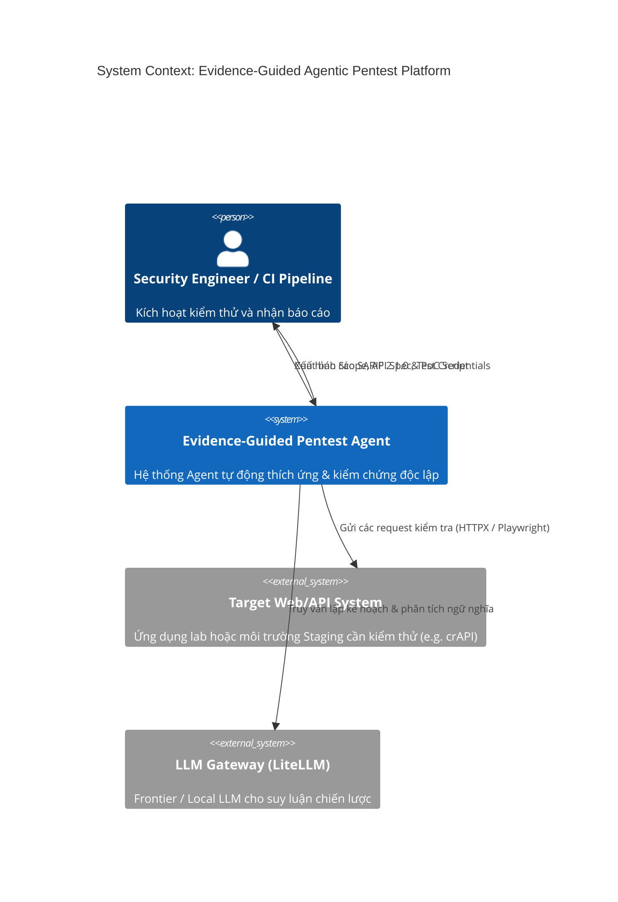
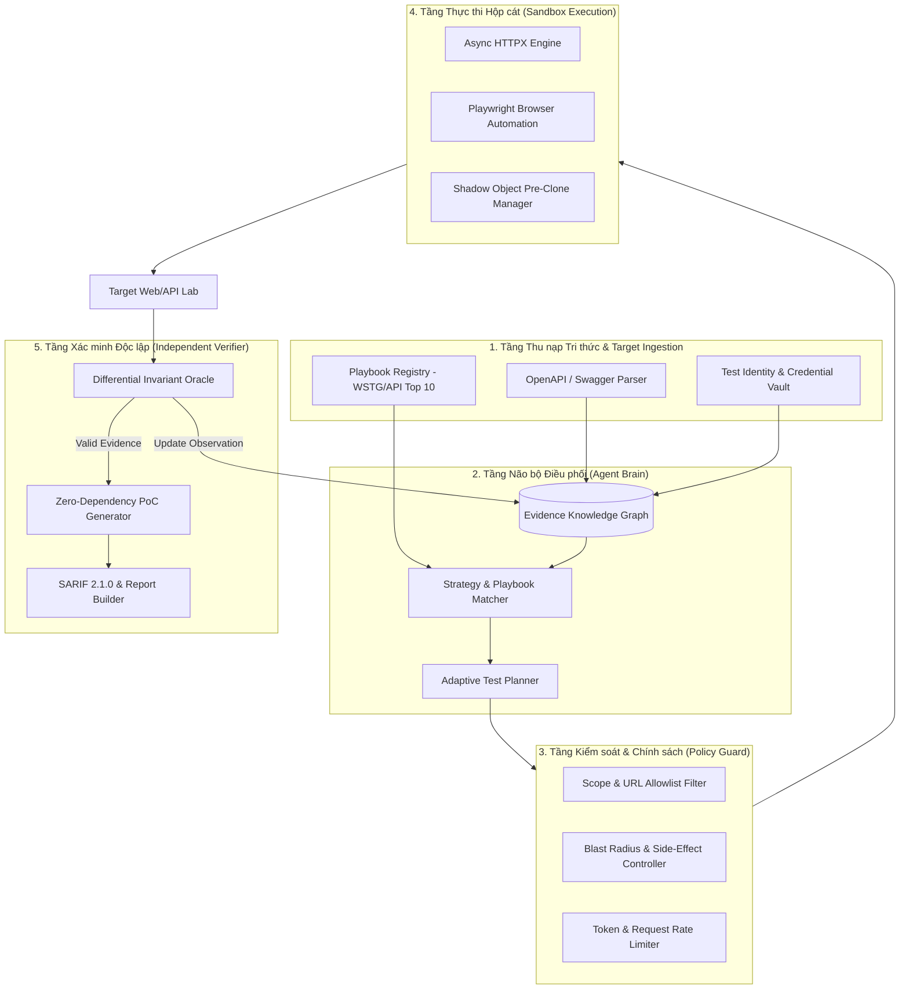
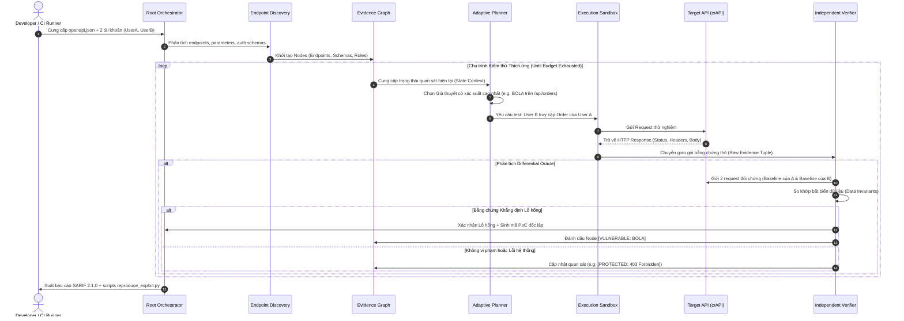

# ĐẶC TẢ KIẾN TRÚC HỆ THỐNG VÀ LUỒNG DỮ LIỆU
## Document ID: SPEC-ARCH-01

---

## 1. MÔ HÌNH C4 - SYSTEM CONTEXT & CONTAINER DIAGRAM

---

## 2. KIẾN TRÚC CONTAINER & NỘI TẠI (CONTAINER LEVEL)

---

## 3. LUỒNG DỮ LIỆU TỪNG BƯỚC (STEP-BY-STEP DATAFLOW)

---

## 4. CÁC QUY ƯỚC GIAO TIẾP VÀ TRẠNG THÁI (CONTRACTS)
1. **Dữ liệu DTO chuẩn**: Mọi thông tin trao đổi giữa Planner, Executor và Verifier đều phải đóng gói dưới dạng Pydantic Model không đổi (Immutable Dataclass).
2. **Nguyên tắc Đơn hướng**: Verifier chỉ nhận kết quả từ Executor và đối soát với Target, không cho phép Planner can thiệp vào quyết định của Verifier nhằm đảm bảo tính khách quan học thuật.
