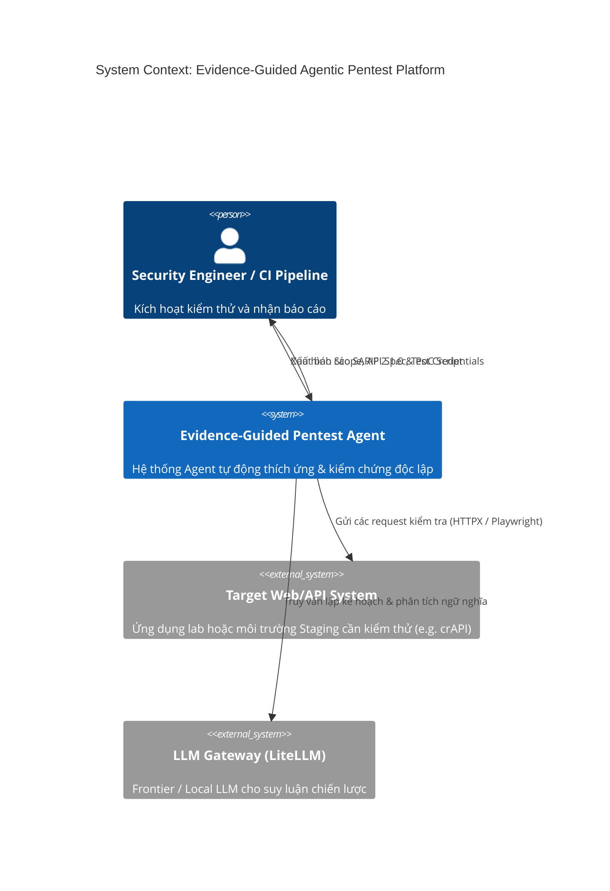
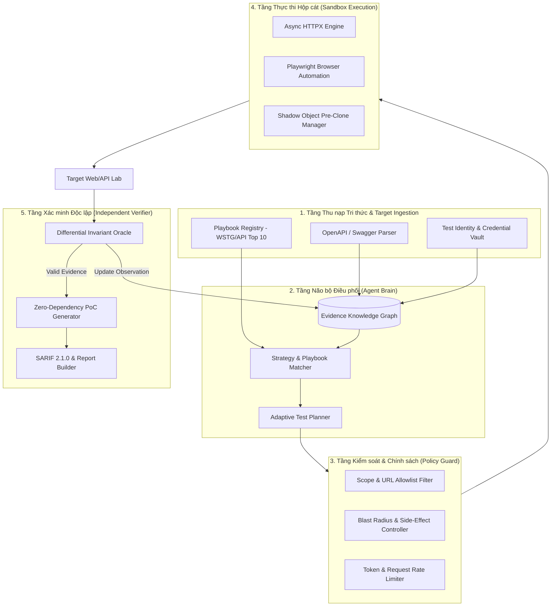
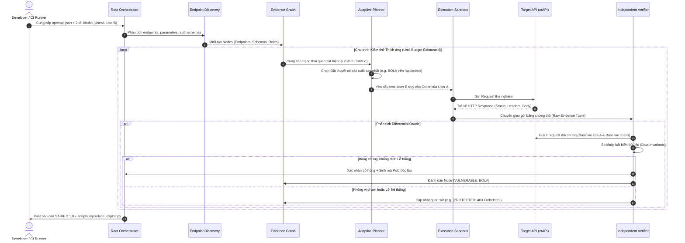
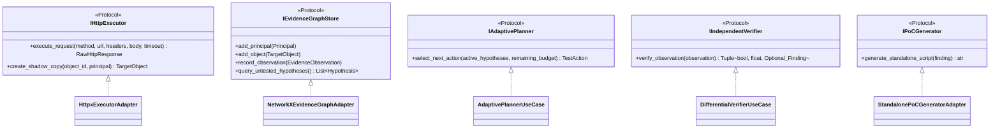

# ĐẶC TẢ KIẾN TRÚC HỆ THỐNG VÀ LUỒNG DỮ LIỆU
## Document ID: SPEC-ARCH-01

---

## 1. MÔ HÌNH C4 - SYSTEM CONTEXT & CONTAINER DIAGRAM



---

## 2. KIẾN TRÚC CONTAINER & NỘI TẠI (CONTAINER LEVEL)



---

## 3. LUỒNG DỮ LIỆU TỪNG BƯỚC (STEP-BY-STEP DATAFLOW)



---

## 4. CÁC QUY ƯỚC GIAO TIẾP VÀ TRẠNG THÁI (CONTRACTS)
1. **Dữ liệu DTO chuẩn**: Mọi thông tin trao đổi giữa Planner, Executor và Verifier đều phải đóng gói dưới dạng Pydantic Model không đổi (Immutable Dataclass).
2. **Nguyên tắc Đơn hướng**: Verifier chỉ nhận kết quả từ Executor và đối soát với Target, không cho phép Planner can thiệp vào quyết định của Verifier nhằm đảm bảo tính khách quan học thuật.

---

## 5. THIẾT KẾ CHI TIẾT CẤP ĐỘ COMPONENT VÀ CHỮ KÝ HÀM (LOW-LEVEL COMPONENT DESIGN)



### 5.1. Chữ ký Hàm Cốt lõi (Core Function Signatures)

#### (a) `application.use_cases.verify_differential.DifferentialVerifierUseCase`
```python
class DifferentialVerifierUseCase:
    def __init__(self, executor: IHttpExecutor, store: IEvidenceGraphStore, invariant_checker: InvariantChecker):
        self.executor = executor
        self.store = store
        self.checker = invariant_checker

    async def verify_observation(
        self,
        observation: EvidenceObservation
    ) -> Tuple[bool, float, Optional[Finding]]:
        \"\"\"
        Xác minh 3 chiều độc lập không phụ thuộc vào trạng thái Planner:
        1. Gửi request lấy baseline của Victim: R_owner = executor.execute(...)
        2. Gửi request lấy baseline của Attacker: R_attacker = executor.execute(...)
        3. So khớp ngữ nghĩa và bất biến dữ liệu: invariant_checker.check(R_cross, R_owner, R_attacker)
        4. Trả về verdict (True/False), độ tin cậy confidence (0.0 -> 1.0) và Finding nếu vi phạm.
        \"\"\"
```

#### (b) `application.use_cases.plan_next_action.AdaptivePlannerUseCase`
```python
class AdaptivePlannerUseCase:
    def __init__(self, store: IEvidenceGraphStore, reasoning_client: LiteLLMReasoningClient):
        self.store = store
        self.llm = reasoning_client

    async def select_next_action(
        self,
        remaining_budget: int
    ) -> Optional[TestAction]:
        \"\"\"
        1. Đọc đồ thị quan hệ từ store: các endpoint chưa test, các object đã biết.
        2. Sinh prompt ngữ cảnh thu gọn (Compressed Graph Context).
        3. Truy vấn LiteLLM với JSON schema định sẵn để chọn Action tiếp theo có xác suất cao nhất.
        4. Trừ ngân sách token & request.
        \"\"\"
```

---

## 6. DANH SÁCH QUYẾT ĐỊNH KIẾN TRÚC (ARCHITECTURAL DECISION RECORDS - ADRs)

Mọi quyết định kiến trúc then chốt được ghi nhận bằng văn bản chuẩn Nygard tại thư mục [`decisions/`](decisions/):
- [**ADR-0001: Decoupled Adaptive Planner and Independent Verifier Architecture**](decisions/ADR-0001-decoupled-adaptive-planner-and-verifier.md)
- [**ADR-0002: 3-Way Differential Invariant Oracle for BOLA/IDOR Detection**](decisions/ADR-0002-three-way-differential-invariant-oracle.md)
- [**ADR-0003: Shadow Object Cloning for Destructive Mutation Testing**](decisions/ADR-0003-shadow-object-mutation-isolation.md)
- [**ADR-0004: NetworkX and SQLite Hybrid Evidence Graph**](decisions/ADR-0004-networkx-sqlite-hybrid-evidence-graph.md)
- [**ADR-0005: SARIF 2.1.0 Standardization and Zero-Dependency PoC Artifacts**](decisions/ADR-0005-sarif-210-and-zero-dependency-poc.md)

