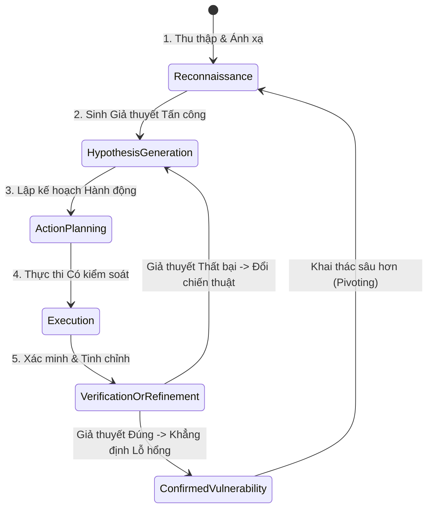

# ĐẶC TẢ TƯ DUY ĐỐI KHÁNG VÀ MÔ HÌNH HÓA MỐI ĐE DỌA
## Document ID: SPEC-MINDSET-02

---

## 1. SO SÁNH TƯ DUY: QA / FUZZER VS. ATTACKER MENTAL MODEL

| Tiêu chí | Fuzzing / QA Scanner Truyền thống | Attacker Mental Model (Agentic Pentest) |
|---|---|---|
| **Mục tiêu chính** | Tìm crash, lỗi 500, lỗi cú pháp, vi phạm schema | Tìm **vi phạm quyền hạn hợp lệ (Logic Invariants)** |
| **Chiến thuật** | Bơm payload ngẫu nhiên (Fuzz string, SQLi payloads, XSS vectors) | **Đổi danh tính, hoán đổi ngữ cảnh (Context Switching)** |
| **Nhận thức Trạng thái** | Phần lớn là Không trạng thái (Stateless request-response) | **Đầy đủ trạng thái (Stateful multi-step workflows)** |
| **Định nghĩa Thành công** | Server phản hồi khác thường hoặc sập | Server phản hồi `HTTP 200` nhưng dữ liệu thuộc về người khác |
| **Cách xử lý lỗi** | Bỏ qua hoặc thử lại mù quáng | **Học từ phản hồi để tinh chỉnh giả thuyết tiếp theo** |

---

## 2. VÒNG LẶP NHẬN THỨC ĐỐI KHÁNG (ATTACKER COGNITIVE LOOP)

Agent Pentest mô phỏng chính xác quá trình tư duy của một Chuyên gia Đánh giá An ninh mạng cấp cao thông qua vòng lặp 5 bước:



### Chi tiết 5 bước tư duy:
1. **Reconnaissance (Trinh sát & Ánh xạ quan hệ)**:
   - Thay vì chỉ liệt kê URL, tư duy tấn công đặt câu hỏi: *"Endpoint này tác động lên tài nguyên gì? Ai là chủ nhân của tài nguyên đó? Token nào đang được dùng để chứng minh quyền sở hữu?"*
2. **Hypothesis Generation (Sinh giả thuyết lỗ hổng)**:
   - *"Nếu tôi dùng token của User B để gọi API xem hóa đơn `order_id=A_01` của User A, liệu backend kiểm tra session ID hay chỉ tin tưởng tham số trên URL?"*
3. **Action Planning (Kế hoạch tối thiểu)**:
   - Thiết kế chuỗi hành động ngắn nhất với chi phí request thấp nhất:
     - Bước 1: Đăng nhập User A $
ightarrow$ Tạo đơn hàng mẫu $
ightarrow$ Lưu `order_id`.
     - Bước 2: Đăng nhập User B $
ightarrow$ Gọi API đọc `order_id` của A.
4. **Execution (Thực thi an toàn)**:
   - Gửi gói tin được định dạng chính xác, giữ nguyên các header bắt buộc để tránh bị chặn bởi WAF/Rate Limiting.
5. **Verification & Refinement (Phản biện và Tinh chỉnh)**:
   - Nếu bị `403 Forbidden`: Tự hỏi *"Có phải do ID dạng UUID khó đoán? Có endpoint nào khác làm lộ UUID của A không (ID Harvesting)?"* $
ightarrow$ Chuyển hướng sang trinh sát mở rộng.

---

## 3. MÔ HÌNH HÓA MỐI ĐE DỌA (THREAT MODELING THEO STRIDE-API)

Đặc tả này tập trung vào 3 mối đe dọa trọng tâm trong STRIDE đối với kiến trúc API:

```
[Mục tiêu: API Gateway / Microservices]
   │
   ├── S - Spoofing Identity (Giả mạo danh tính)
   │     └── Test: Giả mạo JWT header, algorithm confusion (None/RS256->HS256)
   │
   ├── T - Tampering Data (Sửa đổi trái phép - BOLA Write)
   │     └── Test: User B gửi PUT/PATCH/DELETE đối với object của User A
   │
   └── I - Information Disclosure (Rò rỉ thông tin - BOLA Read)
         └── Test: User B gửi GET đối với object riêng tư của User A
```
