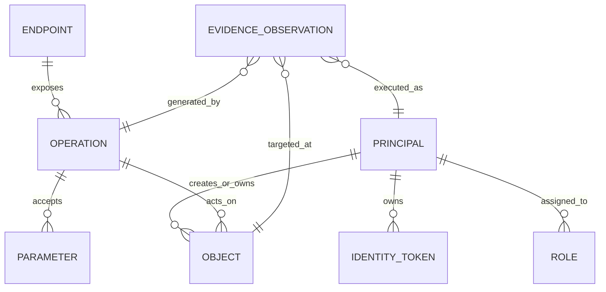

# ĐẶC TẢ MÔ HÌNH DỮ LIỆU VÀ ĐỒ THỊ BẰNG CHỨNG (EVIDENCE GRAPH)
## Document ID: SPEC-DATA-03

---

## 1. CẤU TRÚC ĐỒ THỊ BẰNG CHỨNG (EVIDENCE KNOWLEDGE GRAPH)

Mô hình dữ liệu cốt lõi của Agent là một **Đồ thị không đồng nhất có hướng (Directed Heterogeneous Property Graph)** biểu diễn thế giới quan của mục tiêu:



---

## 2. SCHEMA CÁC THỰC THỂ CỐT LÕI (CORE ENTITY SCHEMAS)

### 2.1. Thực thể Danh tính (`Principal`)
```python
from dataclasses import dataclass, field
from enum import Enum
from typing import Dict, List, Optional

class RoleType(Enum):
    ANONYMOUS = "anonymous"
    STANDARD_USER = "standard_user"
    PREMIUM_USER = "premium_user"
    TENANT_ADMIN = "tenant_admin"
    SUPER_ADMIN = "super_admin"

@dataclass(frozen=True)
class Principal:
    id: str                        # Mã định danh duy nhất (e.g. "user_alice")
    username: str                  # Username đăng nhập
    role: RoleType                 # Vai trò phân quyền
    tenant_id: Optional[str] = None # Đơn vị thuê (cho multi-tenancy testing)
    metadata: Dict[str, str] = field(default_factory=dict)
```

### 2.2. Thực thể Phiên & Token (`IdentityToken`)
```python
@dataclass
class IdentityToken:
    principal_id: str              # Thuộc về Principal nào
    auth_header_name: str          # e.g. "Authorization" hoặc "Cookie"
    token_value: str               # e.g. "Bearer eyJhbGci..."
    expires_at: Optional[float] = None
    is_revoked: bool = False
```

### 2.3. Thực thể Đối tượng Dữ liệu (`TargetObject`)
```python
@dataclass
class TargetObject:
    object_type: str               # Loại tài nguyên (e.g. "order", "vehicle", "profile")
    object_id: str                 # ID cụ thể (e.g. "uuid-1234" hoặc "105")
    owner_principal_id: str        # Chủ sở hữu hợp pháp theo ground truth
    creation_request_id: Optional[str] = None
    properties: Dict[str, str] = field(default_factory=dict) # Các trường dữ liệu nhận diện
    is_shadow_clone: bool = False  # Đánh dấu bản sao tạm thời để bảo vệ dữ liệu gốc
```

### 2.4. Thực thể Quan sát Bằng chứng (`EvidenceObservation`)
```python
@dataclass(frozen=True)
class EvidenceObservation:
    observation_id: str
    timestamp: float
    endpoint: str                  # e.g. "/api/v1/orders/{order_id}"
    method: str                    # "GET", "PUT", "DELETE", ...
    acting_principal_id: str       # Người thực hiện request
    target_object_id: str          # Đối tượng bị thao tác
    target_owner_id: str           # Chủ sở hữu thật sự của đối tượng
    
    # Dữ liệu mạng chi tiết
    request_headers: Dict[str, str]
    request_body: Optional[str]
    response_status: int
    response_headers: Dict[str, str]
    response_body: str
    
    # Nhãn phân loại từ Verifier
    is_violation: bool             # True nếu vi phạm phân quyền thực sự
    violation_type: Optional[str]  # e.g. "BOLA_READ", "BOLA_WRITE", "BFLA"
    confidence_score: float        # Độ tin cậy từ 0.0 -> 1.0
```

---

## 3. CƠ CHẾ CẬP NHẬT TRẠNG THÁI (STATE TRANSITION INVARIANTS)
Đồ thị bằng chứng bảo đảm các bất biến logic sau trong suốt quá trình chạy:
1. **Uniqueness**: Không có hai `TargetObject` cùng loại trùng ID trong cùng một tenant.
2. **Provenance**: Mọi `EvidenceObservation` đều phải lưu trữ đầy đủ raw HTTP trace (request + response) để bảo đảm khả năng tái lập độc lập 100%.
