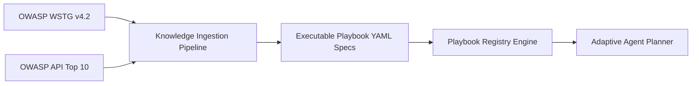

# ĐẶC TẢ PENTEST PLAYBOOK VÀ CƠ SỞ TRI THỨC THỰC THI ĐƯỢC
## Document ID: SPEC-PLAYBOOK-04

---

## 1. TRIẾT LÝ: TỪ TÀI LIỆU LÝ THUYẾT ĐẾN MÃ MÁY THỰC THI (EXECUTABLE PLAYBOOKS)

Các tài liệu như **OWASP WSTG** (Web Security Testing Guide) hay **OWASP API Security Top 10** là cẩm nang cho con người. Để Agent có thể tư duy và thực thi, chúng phải được chuyển hóa thành các **Playbook YAML có cấu trúc xác định**.



---

## 2. PLAYBOOK SCHEMA SPECIFICATION (JSON SCHEMA / YAML)

Mỗi file playbook phải tuân thủ nghiêm ngặt định dạng sau:

```yaml
playbook_id: "WSTG-ATHZ-04-BOLA-01"
title: "Kiểm thử Broken Object Level Authorization trên API Đọc dữ liệu (BOLA Read)"
version: "1.0.0"

classification:
  cwe: "CWE-639"
  owasp_api_top10: "API1:2023"
  owasp_wstg: "WSTG-ATHZ-04"
  severity: "HIGH"

prerequisites:
  required_principals_count: 2     # Cần ít nhất 2 user (UserA và UserB)
  requires_object_ownership: true  # Cần biết trước object nào thuộc về ai
  http_methods: ["GET"]
  endpoint_pattern: ".*/(users|orders|accounts|vehicles)/{[^/]+}.*"

hypothesis_template: >
  Endpoint '{endpoint}' cho phép người dùng '{attacker}' đọc dữ liệu tài nguyên '{object_type}:{object_id}' 
  thuộc sở hữu hợp pháp của '{victim}' mà không kiểm tra quan hệ sở hữu.

execution_strategy:
  step_1_baseline_owner:
    action: "SEND_REQUEST"
    principal: "{victim}"
    object_id: "{victim_object_id}"
    expected_status: 200
    save_response_as: "baseline_owner_response"

  step_2_cross_access:
    action: "SEND_REQUEST"
    principal: "{attacker}"
    object_id: "{victim_object_id}"
    save_response_as: "cross_access_response"

  step_3_baseline_attacker:
    action: "SEND_REQUEST"
    principal: "{attacker}"
    object_id: "{attacker_object_id}"
    expected_status: 200
    save_response_as: "baseline_attacker_response"

verification_oracle:
  algorithm: "DIFFERENTIAL_INVARIANT_3_WAY"
  checks:
    - rule: "STATUS_CODE_EQUALS"
      expected: 200
      target: "cross_access_response"
    - rule: "SEMANTIC_CONTENT_MATCH"
      reference: "baseline_owner_response"
      target: "cross_access_response"
      similarity_threshold: 0.85
      exclude_fields: ["timestamp", "date", "request_id", "trace_id", "nonce"]
    - rule: "IDENTITY_LEAK_CONFIRMATION"
      must_contain_victim_identifiers: ["email", "ssn", "phone", "vin", "credit_card"]

stop_conditions:
  max_requests: 6
  max_execution_time_seconds: 15
  halt_on_rate_limit: true
```

---

## 3. DANH MỤC CÁC PLAYBOOK MẪU CẦN XÂY DỰNG CHO MVP
1. **`WSTG-ATHZ-04-BOLA-READ`**: Tráo đổi ID trên các phương thức GET.
2. **`WSTG-ATHZ-04-BOLA-WRITE`**: Tráo đổi ID trên các phương thức PUT, PATCH, DELETE (kèm Shadow Clone).
3. **`WSTG-ATHZ-02-BFLA`**: Người dùng thường gọi API quản trị viên (Broken Function Level Authorization).
4. **`WSTG-ATHN-04-NO-AUTH`**: Gọi API riêng tư mà không truyền bất kỳ Authorization Token nào.
