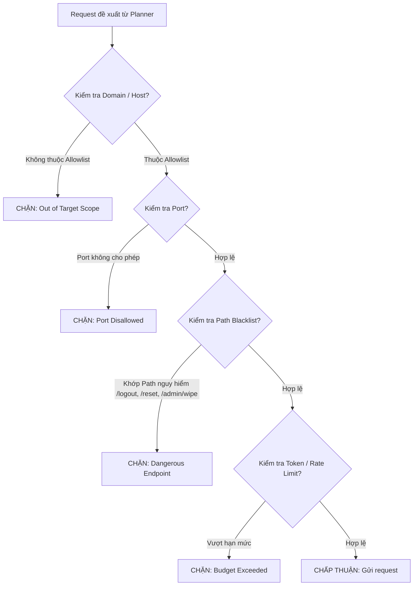

# ĐẶC TẢ CHÍNH SÁCH AN TOÀN, PHẠM VI VÀ BẢO TOÀN TRẠNG THÁI
## Document ID: SPEC-SAFETY-05

---

## 1. MỤC TIÊU CỐT LÕI CỦA POLICY & SCOPE GUARD
Trong kiểm thử xâm nhập tự động, Agent có thể phát sinh các hành vi ngoài ý muốn nếu không được kiểm soát chặt chẽ:
1. Gửi request ra ngoài phạm vi được phép (Out-of-Scope Leak).
2. Làm cạn kiệt tài nguyên máy chủ bằng lượng request ồ ạt (DoS / Rate-limit flood).
3. Phá hủy dữ liệu của môi trường lab/staging khiến các bài kiểm tra tiếp theo mất hiệu lực (Data Corruption).

---

## 2. QUY TẮC PHẠM VI (SCOPE ALLOWLIST SPECIFICATION)



### Cấu hình Scope Guard YAML mẫu (`scope_policy.yaml`):
```yaml
scope:
  allowed_hosts:
    - "localhost"
    - "127.0.0.1"
    - "crapi-web"
  allowed_ports: [80, 443, 8080, 8888]
  
denied_endpoints_regex:
  - ".*/logout.*"
  - ".*/auth/delete-account.*"
  - ".*/admin/system-reset.*"
  - ".*/mail/purge.*"

rate_limiting:
  max_requests_per_second: 5
  max_total_requests_per_session: 500
  backoff_on_status_429: true
  backoff_seconds: 10
```

---

## 3. CƠ CHẾ QUẢN TRỊ BÁN KÍNH TÁC ĐỘNG (BLAST RADIUS & SHADOW OBJECT CLONING)

Khi kiểm thử các phương thức thay đổi trạng thái (`POST`, `PUT`, `PATCH`, `DELETE`):

```python
class SideEffectGuard:
    def __init__(self, http_client, target_object_manager):
        self.client = http_client
        self.obj_mgr = target_object_manager

    async def prepare_safe_execution(self, method: str, object_id: str, principal: Principal):
        if method.upper() in ["DELETE", "PUT", "PATCH"]:
            # TỰ ĐỘNG NHÂN BẢN ĐỐI TƯỢNG TRƯỚC KHI THỬ NGHIỆM PHÁ HỦY
            shadow_obj = await self.obj_mgr.create_shadow_copy(object_id, principal)
            return shadow_obj.object_id
        return object_id
```

### Nguyên tắc Bất biến An toàn:
- Mọi thao tác `DELETE` chỉ được nhắm vào các đối tượng do chính bộ harness tự tạo ra trong phiên test, tuyệt đối không được xóa đối tượng nền (Seed Data).
- Sau mỗi epoch kiểm thử, Verifier gọi routine dọn dẹp các đối tượng rác (`cleanup_test_artifacts()`).
