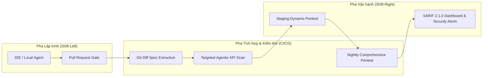

# ĐẶC TẢ TÍCH HỢP QUY TRÌNH PHÁT TRIỂN PHẦN MỀM AN TOÀN (SSDLC)
## Document ID: SPEC-SSDLC-07

---

## 1. ĐỊNH VỊ AGENTIC PENTEST TRONG CHU KỲ SSDLC



---

## 2. CHIẾN LƯỢC KIỂM THỬ TẬP TRUNG THEO GIT-DIFF (SELECTIVE TESTING)
Thay vì quét toàn bộ hệ thống trong mỗi đợt commit (tốn kém thời gian và chi phí LLM), Agent thực hiện kỹ thuật **Git-Diff Targeted Testing**:
1. Lấy diff giữa commit hiện tại và branch `main` trên file `openapi.yaml`.
2. Xác định danh sách các endpoint mới thêm hoặc bị sửa đổi schema.
3. Chỉ nạp các Playbook liên quan trực tiếp đến các endpoint bị thay đổi vào Execution Engine.
$
ightarrow$ **Tiết kiệm 85% - 95% số lượng request và token LLM trong CI pipeline.**

---

## 3. CẤU HÌNH GITHUB ACTIONS MẪU (`.github/workflows/agentic-pentest.yml`)

```yaml
name: Agentic API Security Gate (BOLA Verification)

on:
  pull_request:
    paths:
      - 'services/**'
      - 'api/openapi.yaml'
  schedule:
    - cron: '0 2 * * *' # Chạy toàn diện hàng đêm lúc 2:00 AM

jobs:
  agentic-pentest:
    runs-on: ubuntu-latest
    steps:
      - name: Checkout Code
        uses: actions/checkout@v4

      - name: Start Test Environment (crAPI Lab)
        run: |
          docker compose -f deployments/docker/docker-compose.yml up -d --wait

      - name: Set up Python
        uses: actions/setup-python@v5
        with:
          python-version: '3.11'
          cache: 'pip'

      - name: Install Agent Harness
        run: |
          pip install -r requirements.txt

      - name: Run Evidence-Guided Pentest Agent
        env:
          OPENAI_API_KEY: ${{ secrets.OPENAI_API_KEY }}
          TARGET_BASE_URL: "http://localhost:8888"
          OPENAPI_SPEC_PATH: "api/openapi.yaml"
          MAX_REQUEST_BUDGET: "250"
        run: |
          python -m agentic_pentest.cli run \
            --spec $OPENAPI_SPEC_PATH \
            --target $TARGET_BASE_URL \
            --budget $MAX_REQUEST_BUDGET \
            --output-sarif results.sarif

      - name: Upload SARIF to GitHub Security Center
        uses: github/codeql-action/upload-sarif@v3
        if: always()
        with:
          sarif_file: results.sarif
```

---

## 4. BÁO CÁO CHUẨN SARIF 2.1.0 (STATIC/DYNAMIC ANALYSIS RESULTS FORMAT)
Tất cả các phát hiện được đóng gói theo chuẩn SARIF 2.1.0 quốc tế, cho phép hiển thị trực tiếp vào giao diện Code Scanning của GitHub/GitLab kèm theo code snippet đề xuất khắc phục (Code Fix Recommendation):

```json
{
  "$schema": "https://raw.githubusercontent.com/oasis-tcs/sarif-spec/master/Schemata/sarif-schema-2.1.0.json",
  "version": "2.1.0",
  "runs": [
    {
      "tool": {
        "driver": {
          "name": "Evidence-Guided-Agentic-Pentester",
          "version": "1.0.0",
          "rules": [
            {
              "id": "API1-BOLA-01",
              "name": "BrokenObjectLevelAuthorization",
              "shortDescription": { "text": "Unauthorized access to object via identifier manipulation" },
              "defaultConfiguration": { "level": "error" }
            }
          ]
        }
      },
      "results": [
        {
          "ruleId": "API1-BOLA-01",
          "message": { "text": "BOLA verified: User B successfully retrieved vehicle location of User A via GET /identity/api/v2/vehicle/{id}/location" },
          "locations": [
            {
              "physicalLocation": {
                "artifactLocation": { "uri": "services/identity/server.js" },
                "region": { "startLine": 45, "endLine": 52 }
              }
            }
          ]
        }
      ]
    }
  ]
}
```
