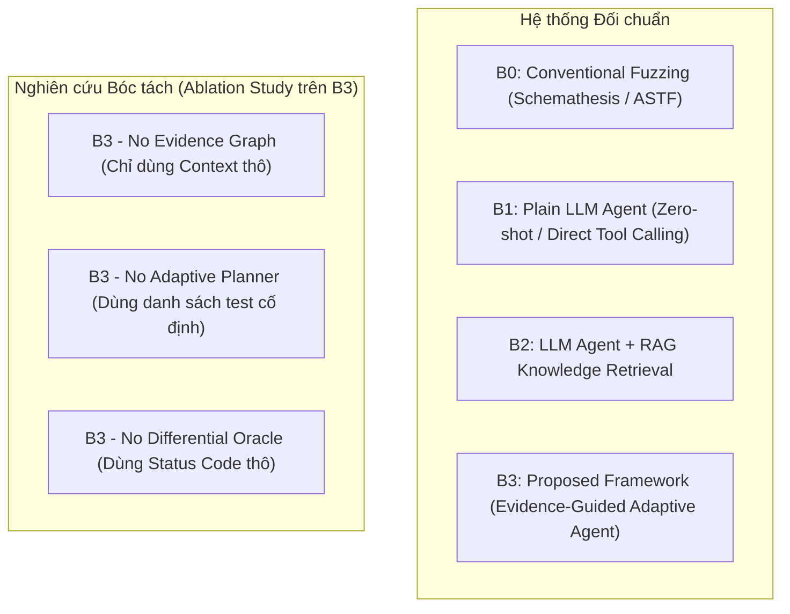

# ĐẶC TẢ THIẾT KẾ ĐO LƯỜNG VÀ THỰC NGHIỆM ĐỐI CHUẨN (BENCHMARK)
## Document ID: SPEC-BENCHMARK-08

---

## 1. THIẾT KẾ THỰC NGHIỆM ĐẠT CHUẨN HỌC THUẬT (SCIENTIFIC METHODOLOGY)

Để một bài báo khoa học về Agentic Security được chấp nhận tại các hội nghị bảo mật hàng đầu, hệ thống thực nghiệm bắt buộc phải có:
1. **Môi trường lab có Ground Truth tuyệt đối**: Biết chính xác có bao nhiêu lỗ hổng, nằm ở endpoint nào, cần điều kiện gì để kích hoạt.
2. **Các Baseline đối trọng công bằng (Fair Baselines)**: Chạy trên cùng môi trường, cùng tài khoản, cùng giới hạn request.
3. **Phân tích bóc tách thành phần (Ablation Study)**: Chứng minh từng module đóng góp bao nhiêu phần trăm vào thành công chung.
4. **Ý nghĩa thống kê (Statistical Significance)**: Chạy lặp lại tối thiểu 5 - 10 lần với các seed khác nhau, báo cáo phương sai (variance) và p-value.

---

## 2. MA TRẬN BASELINES BẮT BUỘC ĐỐI CHIẾU

| Tên Baseline | Đặc điểm cấu hình | Mục đích đối chứng |
|---|---|---|
| **B0: Schemathesis / ASTF** | Fuzzing dựa trên OpenAPI schema, không dùng LLM | Đo hiệu quả của việc đưa AI vào so với công cụ kiểm thử truyền thống |
| **B1: Plain LLM Agent** | Prompt LLM trực tiếp gọi công cụ, không có bộ nhớ đồ thị | Đo lường năng lực suy luận thuần túy của LLM |
| **B2: RAG-based Agent** | LLM kết hợp vector search WSTG nhưng không có State Machine | Chứng minh RAG đơn thuần không đủ để pentest logic nhiều bước |
| **B3: Đề xuất của bạn** | Đồ thị Bằng chứng + Adaptive Planner + Differential Oracle | Khẳng định ưu thế vượt trội của giải pháp đề xuất |

---

## 3. CÁC CHỈ SỐ ĐO LƯỜNG CỐT LÕI (EVALUATION METRICS)

1. **Độ chính xác & Độ bao phủ (Detection Accuracy)**:
   $$\text{Precision} = \frac{TP}{TP + FP}, \quad \text{Recall} = \frac{TP}{TP + FN}, \quad F_1 = 2 \cdot \frac{\text{Precision} \cdot \text{Recall}}{\text{Precision} + \text{Recall}}$$
   * *Trong đó*: $TP$ (True Positive) là lỗ hổng BOLA có thật trong Ground Truth được tái lập thành công. $FP$ (False Positive) là báo cáo sai do lỗi mạng hoặc phân tích nhầm.

2. **Hiệu suất Tài nguyên (Resource Efficiency)**:
   - **Requests Per Confirmed Finding (RPCF)**: Số lượng request mạng trung bình để tìm ra 1 lỗ hổng thật:
     $$\text{RPCF} = \frac{\text{Total HTTP Requests}}{\text{Total Confirmed Vulnerabilities}}$$
   - **Tokens Per Confirmed Finding (TPCF)**: Chi phí token LLM trung bình trên một phát hiện.
   - **Time-to-First-Vulnerability (TTFV)**: Thời gian từ lúc khởi chạy đến khi xác minh được lỗ hổng đầu tiên.

3. **Tính Tái lập (Reproducibility)**:
   - Tỷ lệ các file script PoC sinh ra chạy thành công độc lập trong môi trường sạch không cần Agent can thiệp:
     $$\text{PoC Success Rate} = \frac{\text{Số PoC chạy độc lập thành công}}{\text{Tổng số PoC được tạo ra}} \times 100\%$$
